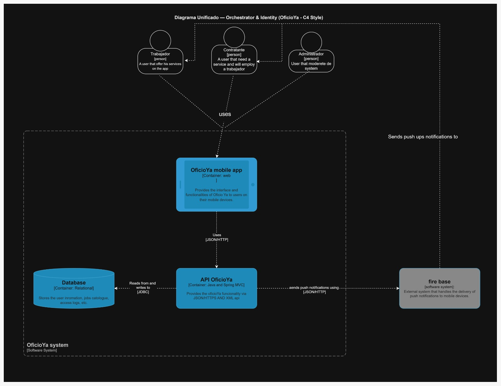
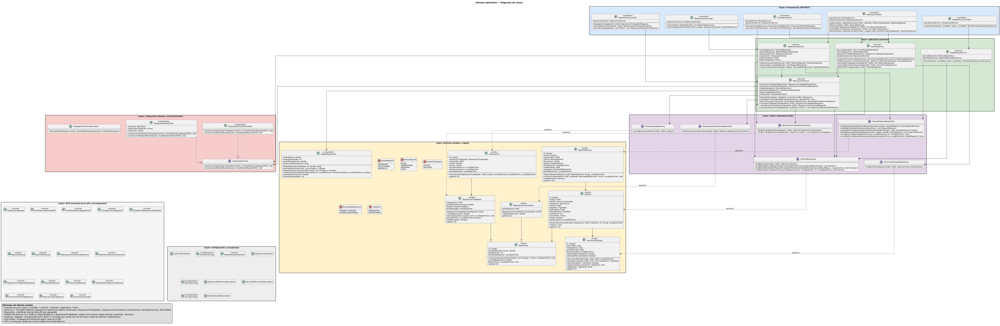
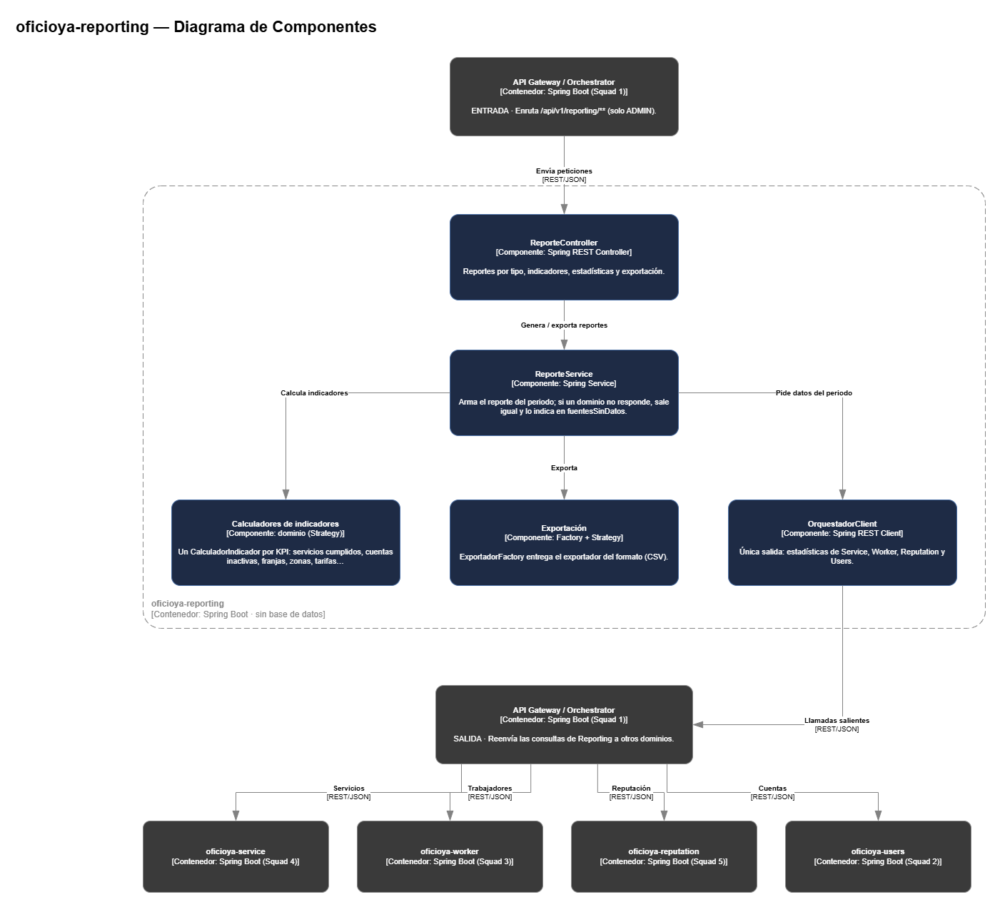
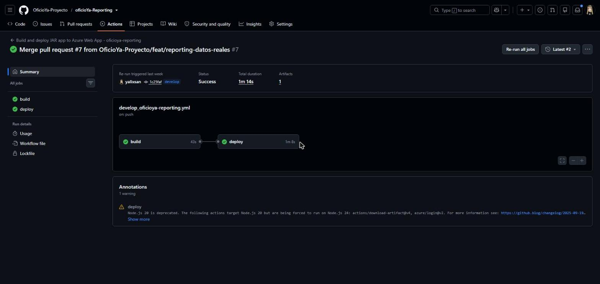
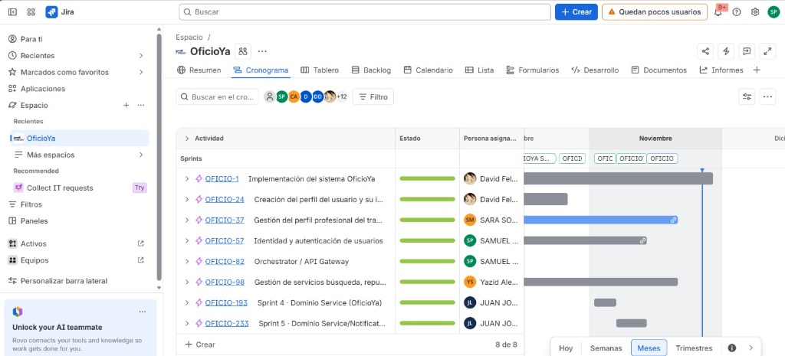

  
  <h1>OficioYa — Portal Técnico y de Arquitectura</h1>

  <!-- Navegación rápida -->
  

    <a href="#1-acceso-a-la-aplicación">Aplicación</a> •
    <a href="#2-ecosistema-de-microservicios">Microservicios</a> •
    <a href="#3-arquitectura-del-sistema-c4-y-uml">Arquitectura y Diagramas</a> •
    <a href="#4-documentación-de-apis-swagger">APIs (Swagger)</a> •
    <a href="#5-infraestructura-y-despliegues">Despliegues</a> •
    <a href="#6-gestión-ágil-scrum--jira">Gestión Scrum</a>
  

---

## 1. Acceso a la Aplicación

> [!IMPORTANT]
> **Entorno Productivo:** Puedes explorar la plataforma funcional directamente desde el siguiente enlace:
> 🔗 **[Abrir Aplicación Web OficioYa]([URL_DEL_FRONTEND_AQUI](https://oficioya-front-app-egh6gjc3b0aearhq.chilecentral-01.azurewebsites.net))**

**OficioYa** conecta de forma directa y equitativa a trabajadores independientes con contratantes locales mediante reputación verificable y gestión de disponibilidad.

---

## 2. Ecosistema de Microservicios

La solución sigue una arquitectura distribuida organizada en **5 dominios funcionales (Squads)** desacoplados:

| Squad | Microservicio(s) | Responsabilidad Principal | Base de Datos / Integración |
| :--- | :--- | :--- | :--- |
| **Squad 1** | **API Gateway & Identity** | Punto único de entrada, validación de JWT, políticas de acceso, registro y 2FA/OTP. | PostgreSQL |
| **Squad 2** | **User, Worker & Subscription** | Gestión de perfiles, oficios, tarifas, zonas de cobertura y suscripciones Pro. | PostgreSQL |
| **Squad 3** | **Service Request** | Ciclo de vida de solicitudes y agenda de disponibilidad. | PostgreSQL |
| **Squad 4** | **Reputation & Notification** | Sistema de calificaciones (1–5 estrellas), reseñas y alertas push en tiempo real. | PostgreSQL / MongoDB / Firebase FCM |
| **Squad 5** | **Reporting & Moderation** | Analítica operativa, auditoría y moderación administrativa de disputas. | PostgreSQL / MongoDB |

---

## 3. Arquitectura del Sistema (C4 y UML)

### Vista General (Nivel 1 y Nivel 2 - Modelo C4)
* **Diagrama de Contexto:** Interacción entre Contratante, Trabajador Independiente, Administrador y servicios externos (Gemini API, Firebase FCM y PSE).

  

* **Diagrama de Contenedores:** Topología completa de la SPA, API Gateway, microservicios de los 5 squads y motores de persistencia.

  

### Vista Detallada por Microservicio (Componentes, Clases y Entidad-Relación)
*Haz clic en cada dominio para desplegar sus diagramas internos:*

<strong>Squad 1: API Gateway (Orchestrator) & Identity Service</strong>

 

- **Diagrama de Componentes - API Gateway (C4 Nivel 3):**
  

- **Diagrama de Componentes - Identity Service (C4 Nivel 3):**
  

- **Diagrama de Clases:**
  

- **Diagrama Entidad-Relación (ER):**
  

<strong>Squad 2: User Service, Worker Service & Subscription Service</strong>

 

- **Diagrama de Componentes (C4 Nivel 3):**
  

- **Diagrama de Clases:**
  

- **Diagrama Entidad-Relación (ER):**
  

<strong>Squad 3: Service Request Service (Core)</strong>

 

- **Diagrama de Componentes (C4 Nivel 3):**
  

- **Diagrama de Clases (Core):**
  

- **Diagrama Entidad-Relación (ER):**
  

<strong>Squad 4: Reputation & Notification Service</strong>

 

- **Diagrama de Componentes (C4 Nivel 3):**
  

- **Diagrama de Clases:**
  

- **Diagrama Entidad-Relación (ER):**
  

<strong>Squad 5: Reporting & Moderation Service</strong>

 

- **Diagrama de Componentes (C4 Nivel 3):**
  

- **Diagrama de Clases:**
  

- **Diagrama Entidad-Relación (ER):**
  

---

## 4. Documentación de APIs (Swagger)

| Microservicio | Documentación Interactiva | Respaldo Visual |
| :--- | :--- | :--- |
| **Service Request** | [Ver Swagger UI](URL_SWAGGER_SERVICE) | [Ver Captura](docs/swagger-respaldo/swagger-service-core.png) |
| **API Gateway / Identity Service** | [Ver Swagger UI](URL_SWAGGER_IDENTITY) | [Ver Captura](docs/swagger-respaldo/swagger-gateway-identity.png) |
| **User & Worker Service** | [Ver Swagger UI](URL_SWAGGER_WORKER) | [Ver Captura](docs/swagger-respaldo/swagger-users-workers.png) |
| **Reputation & Notification Service** | [Ver Swagger UI](URL_SWAGGER_REPUTATION) | [Ver Captura](docs/swagger-respaldo/swagger-reputation-notif.png) |
| **Reporting & Moderation Service** | [Ver Swagger UI](URL_SWAGGER_REPORTING) | [Ver Captura](docs/swagger-respaldo/swagger-reporting-mod.png) |

---

## 5. Infraestructura y Despliegues

Evidencia de integración continua (CI/CD) y ejecución en la nube sobre **Microsoft Azure**:

* **Pipelines de Despliegue (Backend & Frontend):**
  - *Pipeline Backend:*
    
  - *Pipeline Frontend:*
    
* **Recursos Activos en Azure:**
  

---

## 6. Gestión Ágil (Scrum + Jira)

Seguimiento de sprints, ceremonias y trazabilidad de historias de usuario durante el desarrollo:

* **Cronograma y Roadmap (Timeline):**
  
* **Tablero de Sprint:**
  
* **Dashboard y Métricas:**
  
