<div align="center">
  
  <h1>OficioYa — Portal Técnico y de Arquitectura</h1>

  <!-- Navegación rápida -->
  <p>
    <a href="#1-acceso-a-la-aplicación">Aplicación</a> •
    <a href="#2-ecosistema-de-microservicios">Microservicios</a> •
    <a href="#3-arquitectura-del-sistema-c4-y-uml">Arquitectura y Diagramas</a> •
    <a href="#4-documentación-de-apis-swagger">APIs (Swagger)</a> •
    <a href="#5-infraestructura-y-despliegues">Despliegues</a> •
    <a href="#6-gestión-ágil-scrum--jira">Gestión Scrum</a> •
    <a href="#7-manual-de-identidad-y-sistema-de-diseño-frontend">Identidad y Diseño</a>
  </p>
</div>

---

## 1. Acceso a la Aplicación

> [!IMPORTANT]
> **Entorno Productivo:** Puedes explorar la plataforma funcional directamente desde el siguiente enlace:
> 🔗 <a href="https://oficioya-front-app-egh6gjc3b0aearhq.chilecentral-01.azurewebsites.net" target="_blank" rel="noopener noreferrer"><strong>Abrir Aplicación Web OficioYa</strong></a>

**OficioYa** conecta de forma directa y equitativa a trabajadores independientes con contratantes locales mediante reputación verificable y gestión de disponibilidad.

---

## 2. Ecosistema de Microservicios

La solución sigue una arquitectura distribuida organizada en **5 dominios funcionales (Squads)** desacoplados:

| Squad | Microservicio(s) | Responsabilidad Principal | Base de Datos / Integración |
| :--- | :--- | :--- | :--- |
| **Squad 1** | **Orchestrator & Identity** | Punto único de entrada (API Gateway), validación de JWT, políticas de acceso, autenticación y registro. | PostgreSQL |
| **Squad 2** | **Users** | Gestión de usuarios, perfiles de contratantes, datos de contacto y administración de cuentas. | PostgreSQL |
| **Squad 3** | **Workers** | Perfiles profesionales, catálogo de oficios, tarifas estimadas, cobertura por zonas y fotos de trabajos. | PostgreSQL |
| **Squad 4** | **Service Request & Notification** | Ciclo de vida de solicitudes de servicio, agenda de disponibilidad y envío de alertas push y correos. | PostgreSQL / Firebase FCM / Gmail |
| **Squad 5** | **Search, Reputation & Reporting** | Búsqueda y filtrado de trabajadores, sistema de reputación/calificaciones y analítica/reportes para administradores. | PostgreSQL (Reputation) / En memoria (Search y Reporting) |

---

## 3. Arquitectura del Sistema (C4 y UML)

### Vista General (Nivel 1 y Nivel 2 - Modelo C4)
* **Diagrama de Contexto:** Interacción entre Cliente (Contratante), Trabajador Independiente, Administrador y servicios externos de notificación (Firebase y Gmail).

  

* **Diagrama de Componentes:** Topología completa de la SPA, API Gateway, microservicios de los 5 squads y motores de persistencia.

  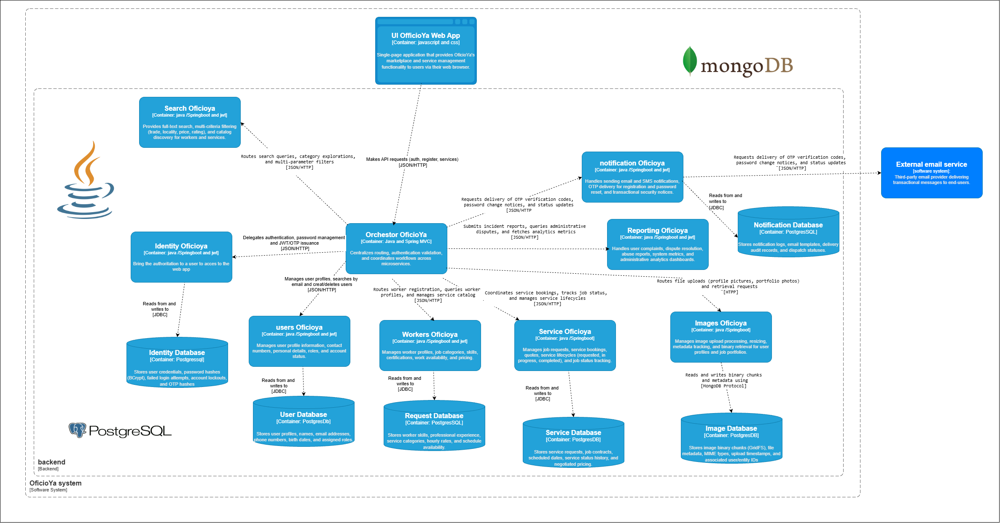

### Vista Detallada por Microservicio (Componentes, Clases y Entidad-Relación)
*Haz clic en cada dominio para desplegar sus diagramas internos:*

<details>
<summary><strong>Squad 1: Orchestrator (API Gateway) & Identity Service</strong></summary>
<br>

- **Diagrama de Componentes - Orchestrator (C4 Nivel 3):**
  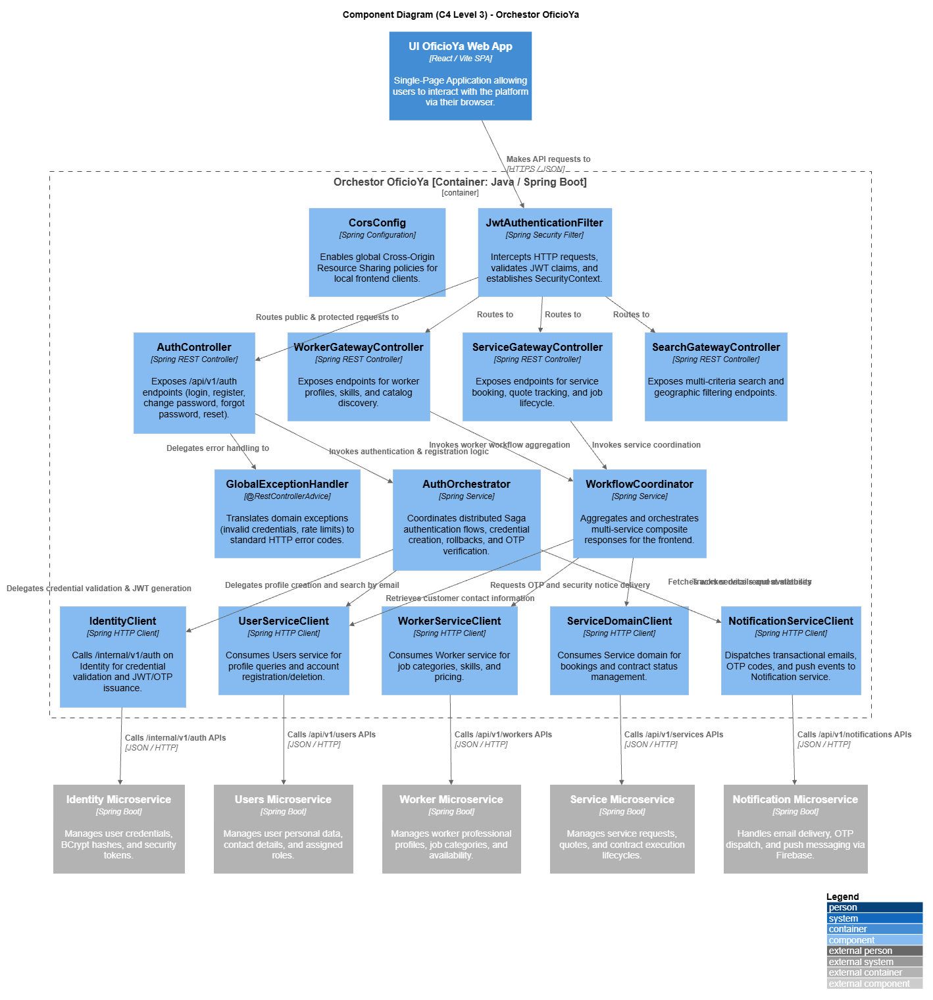

- **Diagrama de Componentes - Identity Service (C4 Nivel 3):**
  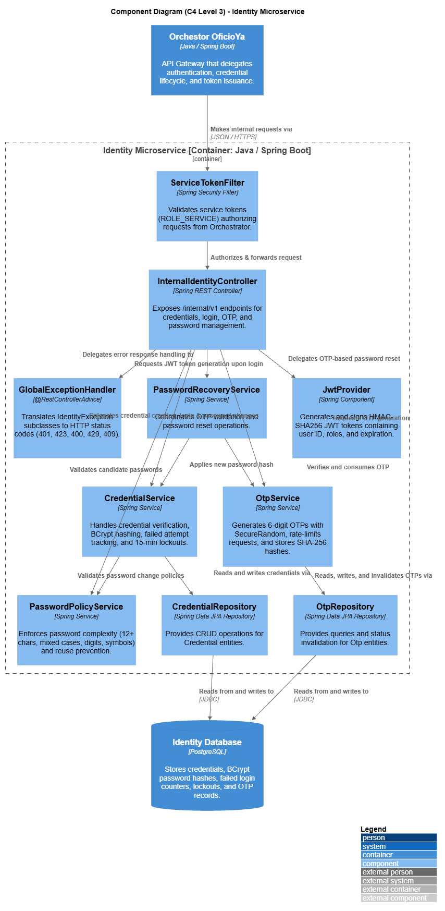

- **Diagrama de Clases:**
  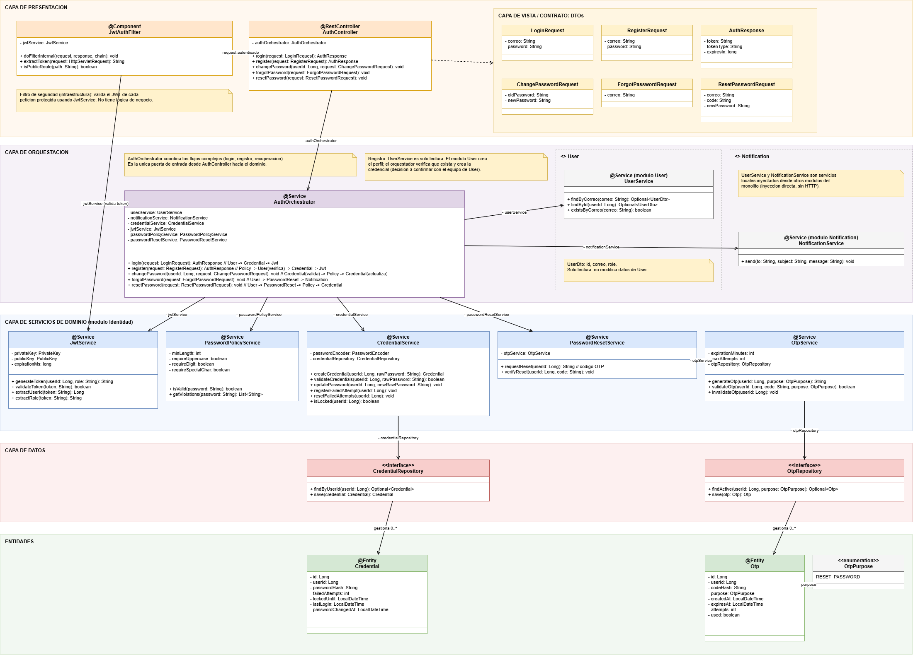

- **Diagrama Entidad-Relación (ER):**
  
</details>

<details>
<summary><strong>Squad 2: User Service</strong></summary>
<br>


- **Diagrama de Clases:**
  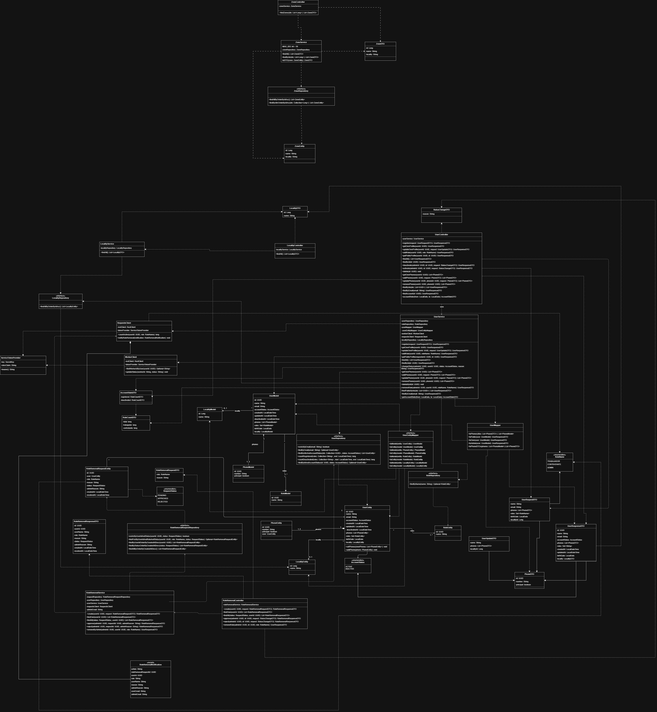

- **Diagrama Entidad-Relación (ER):**
  
</details>

<details>
<summary><strong>Squad 3: Worker Service</strong></summary>
<br>


- **Diagrama de Clases:**
  

- **Diagrama Entidad-Relación (ER):**
  
</details>

<details>
<summary><strong>Squad 4: Service Request & Notification Service</strong></summary>
<br>


- **Diagrama de Clases:**
  

- **Diagrama Entidad-Relación (ER):**
  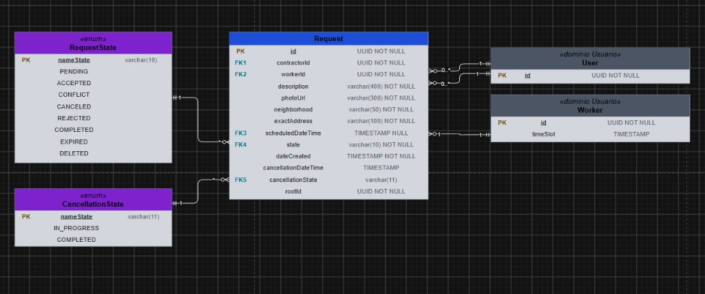
</details>

<details>
<summary><strong>Squad 5: Search, Reputation & Reporting Services</strong></summary>
<br>

- **Diagrama de Contenedores del Squad:**
  

- **Diagramas de Componentes (C4 Nivel 3):**
  - *Search Service:*
    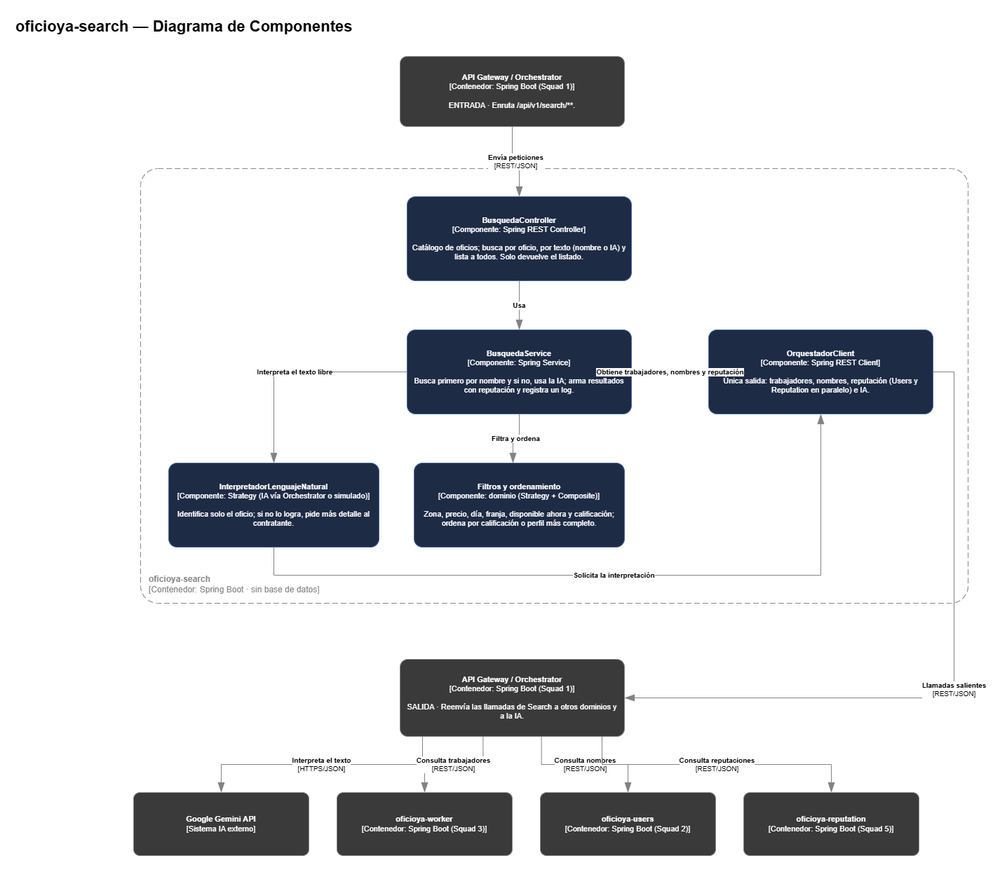
  - *Reputation Service:*
    
  - *Reporting Service:*
    

- **Diagramas de Clases:**
  - *Search Service:*
    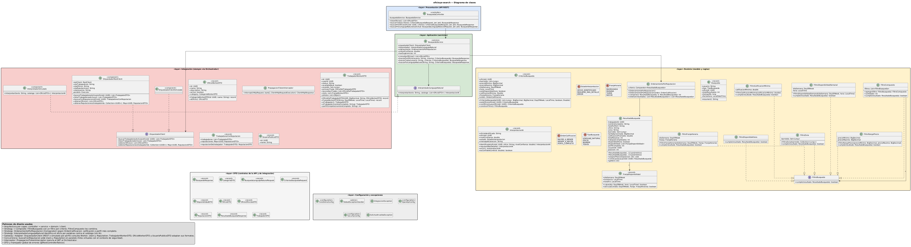
  - *Reputation Service:*
    
  - *Reporting Service:*
    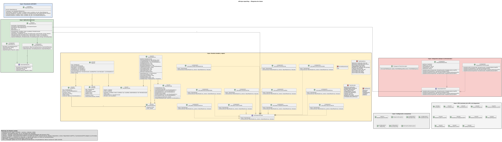

- **Diagrama Entidad-Relación (ER):**
  - *Reputation Service:*
    
  *(Nota: Search y Reporting operan como servicios en memoria sin base de datos propia, consultando a otros dominios en tiempo real).*
</details>

---

## 4. Documentación de APIs (Swagger)

| Microservicio | Squad | Documentación Interactiva | Respaldo Visual |
| :--- | :---: | :--- | :--- |
| **Orchestrator & Identity** | Squad 1 | [Ver Swagger UI](https://oficioya-orchestor-api-ghaxfaacfabxh4bv.chilecentral-01.azurewebsites.net/swagger-ui/index.html) | [Ver Captura](docs/swagger-respaldo/swagger-orchestrator-identity.png) |
| **Users** | Squad 2 | [Ver Swagger UI](https://oficioya-users-api-cmaxb7fphegvdwb3.chilecentral-01.azurewebsites.net/swagger-ui/index.html) | [Ver Captura](docs/swagger-respaldo/swagger-users.png) |
| **Workers** | Squad 3 | [Ver Swagger UI](https://oficioya-worker-api.azurewebsites.net/swagger-ui/index.html) | [Ver Captura](docs/swagger-respaldo/swagger-workers.png) |
| **Service Request** | Squad 4 | [Ver Swagger UI](https://ofioya-serviceapi-achydycpa3fgbsch.chilecentral-01.azurewebsites.net/swagger-ui/index.html#/) | [Ver Captura](docs/swagger-respaldo/swagger-service.png) |
| **Notification** | Squad 4 | [Ver Swagger UI](https://oficioya-notificationapi-apffc2eygzgcbghp.brazilsouth-01.azurewebsites.net/swagger-ui/index.html#/) | [Ver Captura](docs/swagger-respaldo/swagger-notification.png) |
| **Search** | Squad 5 | [Ver Swagger UI](https://oficioya-search-atgjh5gdfcb5b8h3.mexicocentral-01.azurewebsites.net/swagger-ui/index.html) | [Ver Captura](docs/swagger-respaldo/swagger-search.png) |
| **Reputation** | Squad 5 | [Ver Swagger UI](https://oficioya-reputation-bggabfhkdvaqh4bw.mexicocentral-01.azurewebsites.net/swagger-ui/index.html) | [Ver Captura](docs/swagger-respaldo/swagger-reputation.png) |
| **Reporting** | Squad 5 | [Ver Swagger UI](https://oficioya-reporting-hvehegasb3hrarc9.mexicocentral-01.azurewebsites.net/swagger-ui/index.html) | [Ver Captura](docs/swagger-respaldo/swagger-reporting.png) |

---

## 5. Infraestructura y Despliegues

Cada dominio funcional cuenta con despliegue independiente sobre **Microsoft Azure** y flujos automatizados de integración y entrega continua (**CI/CD**) por repositorio:

| Dominio / Capa | Servicio(s) Desplegado(s) | Proveedor Cloud | Estado |
| :--- | :--- | :---: | :---: |
| **Frontend** | Web App (React + TypeScript) | Microsoft Azure | Activo |
| **Squad 1** | Orchestrator (API Gateway) & Identity Service | Microsoft Azure | Activo |
| **Squad 2** | User Service | Microsoft Azure | Activo |
| **Squad 3** | Worker Service | Microsoft Azure | Activo |
| **Squad 4** | Service Request & Notification Service | Microsoft Azure | Activo |
| **Squad 5** | Search, Reputation & Reporting Services | Microsoft Azure | Activo |

*Haz clic en cada bloque para verificar la evidencia en Azure y su pipeline CI/CD:*

<details>
<summary><strong>Frontend — Web App (React + TypeScript)</strong></summary>
<br>

- **Recurso activo en Azure:**
  <!-- Sugerencia de recorte: Se puede recortar la barra lateral de navegación para destacar directamente los datos esenciales de ejecución (Node 22-lts, URL de Chile Central). -->
  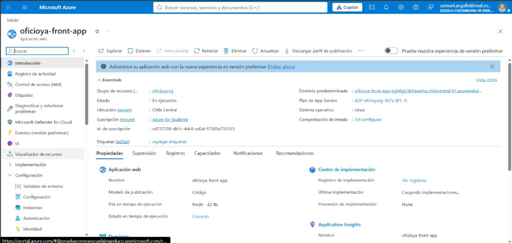
- **Pipeline de despliegue (CI/CD):**
  
</details>

<details>
<summary><strong>Squad 1 — Orchestrator & Identity Service</strong></summary>
<br>

- **Recursos activos en Azure:**
  <!-- Sugerencia de recorte: Para evitar elementos de navegación del navegador (barra izquierda y tooltip inferior), se puede recortar enfocando el panel central de 'Essentials' y propiedades del App Service. -->
  - *Orchestrator (API Gateway):*
    
  - *Identity Service:*
    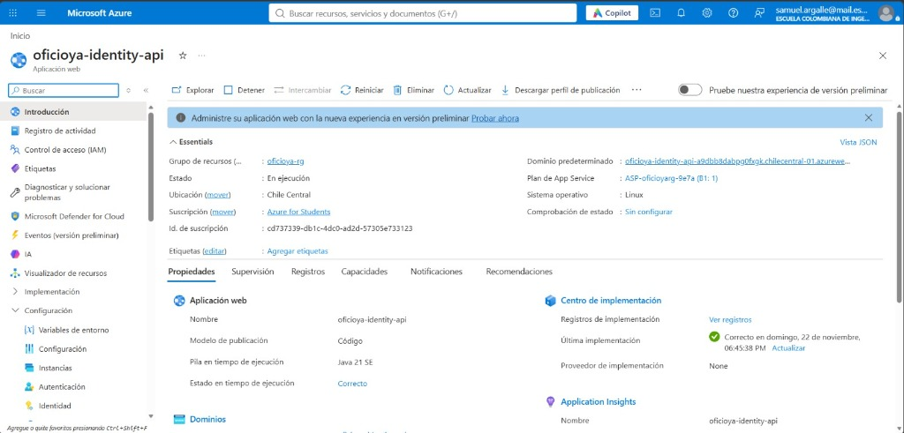
- **Pipelines de despliegue (CI/CD):**
  - *Orchestrator (API Gateway):*
    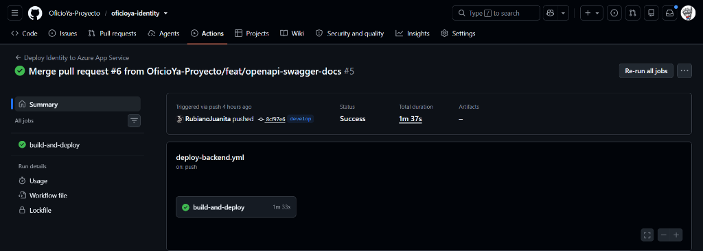
  - *Identity Service:*
    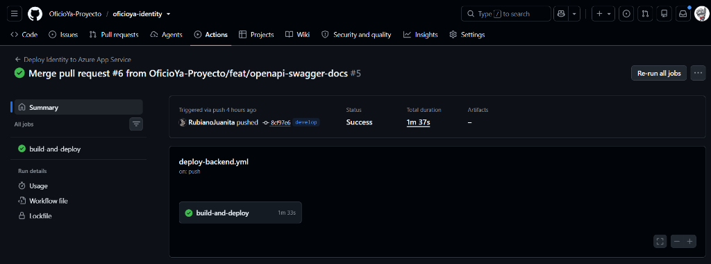
</details>

<details>
<summary><strong>Squad 2 — User Service</strong></summary>
<br>

- **Recursos activos en Azure:**
  
- **Pipeline de despliegue (CI/CD):**
  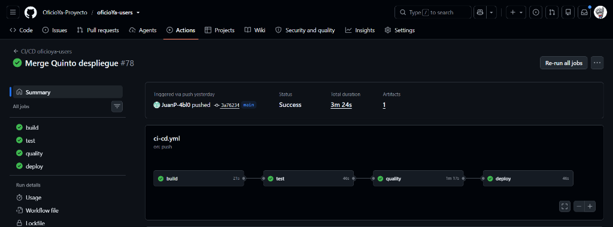
</details>

<details>
<summary><strong>Squad 3 — Worker Service</strong></summary>
<br>

- **Recursos activos en Azure:**
  <!-- Sugerencia de recorte: Para evitar la barra de navegación lateral y el tooltip inferior del navegador, se puede recortar enfocando el panel central de 'Essentials' y 'Propiedades' del App Service (oficioya-worker-api, West US, Java 21 SE). -->
  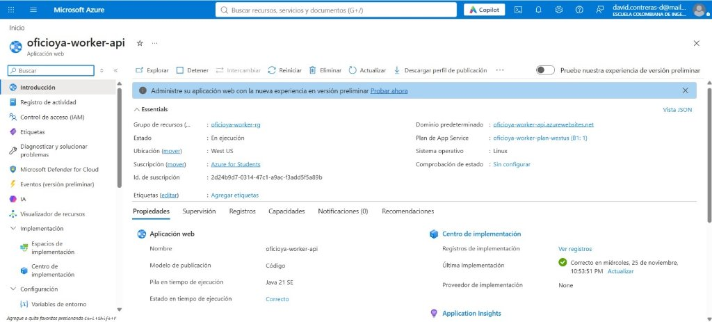
- **Pipeline de despliegue (CI/CD):**
  
</details>

<details>
<summary><strong>Squad 4 — Service Request & Notification Service</strong></summary>
<br>

- **Recursos activos en Azure:**
  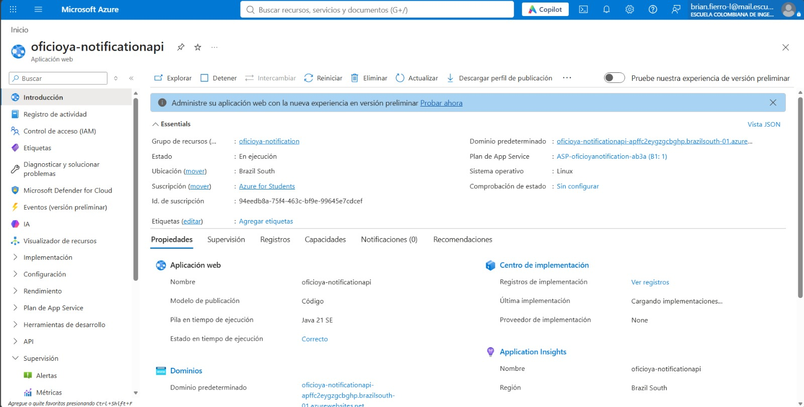
- **Pipelines de despliegue (CI/CD):**
  - *Service Request:*
    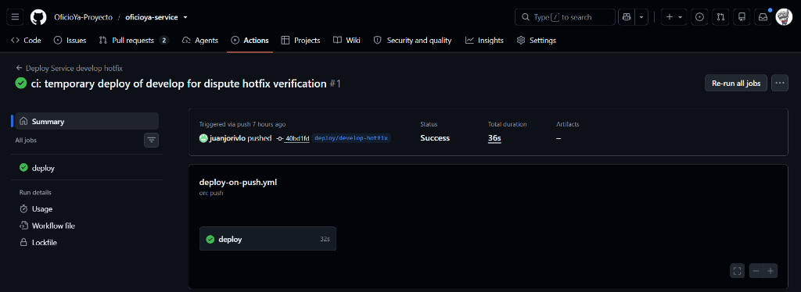
  - *Notification Service:*
    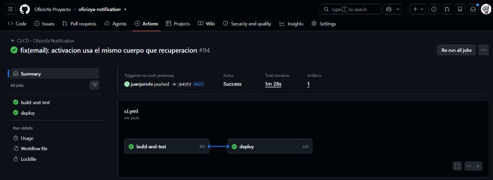
</details>

<details>
<summary><strong>Squad 5 — Search, Reputation & Reporting Services</strong></summary>
<br>

- **Recursos activos en Azure:**
  - *Vista General de App Services (Squad 5 en ejecución):*
    <!-- Sugerencia de recorte: Se puede recortar el espacio en blanco inferior de la tabla para enfocar directamente las 3 filas con los servicios en ejecución. -->
    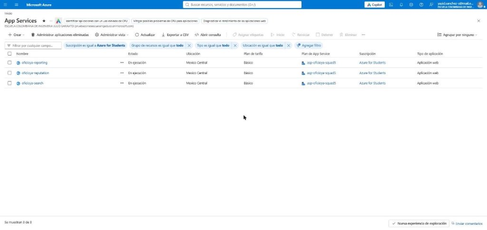
  - *Search Service:*
    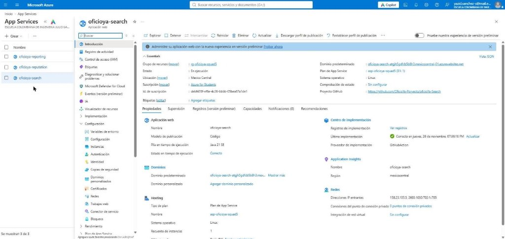
  - *Reputation Service:*
    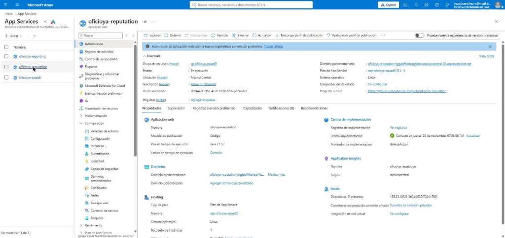
  - *Reporting Service:*
    
- **Pipelines de despliegue (CI/CD):**
  - *Pipeline Search:*
    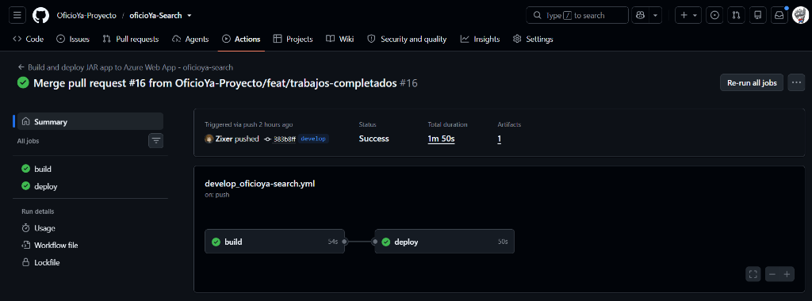
  - *Pipeline Reputation:*
    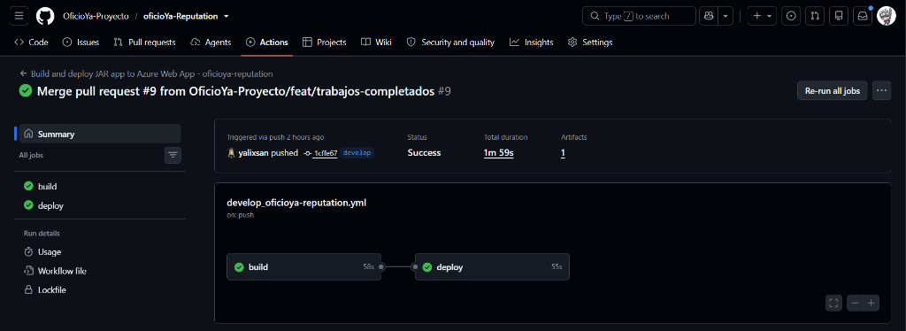
  - *Pipeline Reporting:*
    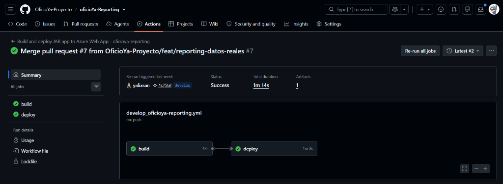
</details>

---

## 6. Gestión Ágil (Scrum + Jira)

Seguimiento de sprints, ceremonias y trazabilidad de historias de usuario durante el desarrollo:

* **Cronograma y Roadmap (Timeline):**
  <!-- Sugerencia de recorte / ajuste: La captura actual tiene abierto el desplegable de 'Persona asignada' sobre el diagrama de Gantt. Se sugiere tomar una nueva captura con el menú cerrado para ver despejadas las barras temporales. -->
  

* **Tablero de Sprint (Sprint 6 activo):**
  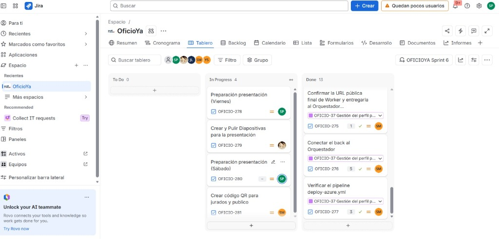

* **Dashboard y Métricas:**
  - *Reporte Burnup (Trabajo completado vs Alcance del Sprint 5):*
    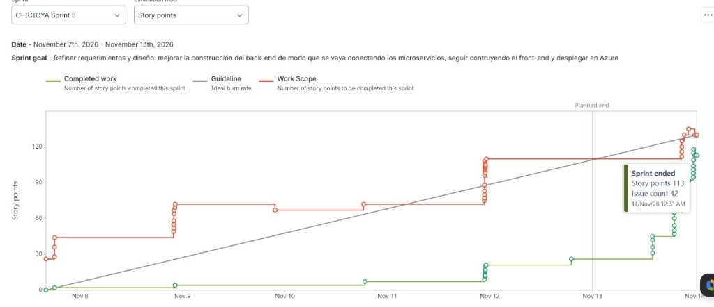
  - *Reporte Burndown (Trabajo restante del Sprint 5):*
    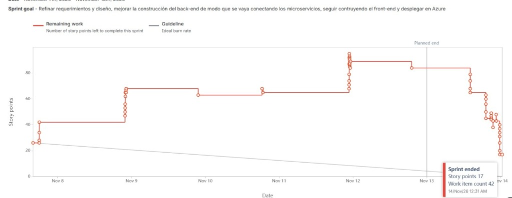

---

## 7. Manual de Identidad y Sistema de Diseño (Frontend)

Documentación de la identidad visual, verbal y de interfaz implementada en **OficioYa** (`OficioYa-Front`), que define los tokens de diseño y criterios aplicados en la plataforma web.

### 7.1 Esencia de Marca

OficioYa existe para que contratar un oficio sea tan simple y seguro como pedir ayuda a un vecino de confianza.

| Elemento | Definición |
| :--- | :--- |
| **Propósito** | Que encontrar a un profesional de confianza sea fácil, rápido y seguro. |
| **Misión** | Conectar a personas con profesionales de oficios verificados, con precios claros y seguimiento del servicio. |
| **Visión** | Ser la primera opción de los hogares al necesitar un arreglo y dar trabajo estable a quienes viven de su oficio. |
| **Valores** | Confianza, cercanía, rapidez, claridad y dignidad del oficio. |
| **Personalidad** | Cercana, resolutiva, confiable y respetuosa. Nunca fría ni burocrática. |
| **Público** | **Contratantes:** hogares y pequeños negocios urbanos en Bogotá. **Trabajadores:** técnicos independientes que buscan más clientes en Bogotá. |
| **Propuesta de valor** | Un profesional verificado, a tu puerta, hoy. |
| **Eslogan** | Tu arreglo, ya. |

---

### 7.2 Logotipo y Reglas de Uso

El logotipo combina un símbolo (mano abierta de trazo continuo de la que sale una llave de boca) y el nombre **«OficioYa»** (**«Oficio»** en Azul Taller `#1E2D40` y **«Ya»** en Terracota Ya `#DC623F`).

| Regla | Especificación aplicada en el proyecto |
| :--- | :--- |
| **Versiones** | Principal horizontal en barra superior (`Logo.png`), versión vectorial en componente (`BrandLogo.jsx` en variantes `color` y `white`) e ícono de aplicación (`favicon.png`). |
| **Área de seguridad** | Espacio libre alrededor del logo equivalente a la altura de la letra «Y» (`padding: 8px 32px` en barra superior). |
| **Tamaño en interfaz** | Barra de navegación escritorio: `62 px` de alto (`50 px` en móvil). Encabezado del menú lateral (Drawer): `54 px` de alto. Componente `BrandLogo`: mínimo `36 px`. |
| **Sobre fondo Marfil o Blanco** | Versión principal a color (`Logo.png` / `variant="color"`). |
| **Sobre fondos oscuros** | Versión en blanco (`variant="white"`). |
| **Archivos en repositorio** | `src/assets/Logo.png` (fondo transparente), `src/assets/logo.jpg`, `public/favicon.png` y `src/modules/core/components/BrandLogo.jsx`. |

> [!WARNING]
> **Usos incorrectos:** Deformar la proporción (proteger siempre con `object-fit: contain`), cambiar los colores institucionales, separar la llave de la mano o colocar el logo sobre fondos sin contraste suficiente.

---

### 7.3 Paleta de Color y Tokens

La paleta implementada sigue la proporción armónica **60 / 30 / 10**:
* **60% Neutros cálidos:** Marfil Cálido (`#FFFCF7`), Blanco (`#FFFFFF`) y Arena Suave (`#F6F1E8`) para fondos y tarjetas.
* **30% Estructura y lectura:** Verde Pizarra (`#24312D`), Gris Salvia (`#68736F`) y Borde Cálido (`#E4DED4`) para tipografía y contenedores.
* **10% Acento de marca:** Terracota Ya (`#DC623F`) y Terracota Oscuro (`#B7462B`) para acciones primarias y destacados.

| Nombre | Variable CSS | HEX | RGB | Uso en la interfaz |
| :--- | :--- | :--- | :--- | :--- |
| **Terracota Ya** | `--color-primary` | `#DC623F` | `220, 98, 63` | Botón de acción principal, «Ya» del logo, badges de notificación y enlaces activos. |
| **Terracota Hover** | `--color-primary-hover` | `#C9532F` | `201, 83, 47` | Estado `:hover` de botones primarios. |
| **Terracota Suave** | `--color-primary-soft` | `#FFF0E9` | `255, 240, 233` | Fondos suaves de íconos, badges informativos y estados activos en menú lateral. |
| **Terracota Oscuro** | `--color-accent` | `#B7462B` | `183, 70, 43` | Encabezados tipo *eyebrow*, píldoras de rol principal y textos de énfasis. |
| **Azul Taller** | *(Logo)* | `#1E2D40` | `30, 45, 64` | Trazo del símbolo y palabra «Oficio» en el logotipo oficial. |
| **Verde Pizarra** | `--color-text` | `#24312D` | `36, 49, 45` | Texto principal, títulos (`H1`, `H2`, `H3`) e íconos de navegación. |
| **Gris Salvia** | `--color-text-muted` | `#68736F` | `104, 115, 111` | Texto secundario, subtítulos, descripciones y etiquetas de apoyo. |
| **Marfil Cálido** | `--color-bg` | `#FFFCF7` | `255, 252, 247` | Fondo general de pantallas, barra superior e interior de campos de formulario. |
| **Blanco** | `--color-surface` | `#FFFFFF` | `255, 255, 255` | Superficie de tarjetas (`.card`), modales, menú lateral (Drawer) y desplegables. |
| **Arena Suave** | `--color-surface-alt` | `#F6F1E8` | `246, 241, 232` | Paneles secundarios, hover de botones circulares y secciones alternas. |
| **Borde Cálido** | `--color-border` | `#E4DED4` | `228, 222, 212` | Bordes de `1 px` en tarjetas, inputs, selectores y divisores. |
| **Verde Éxito** | `--color-success` | `#2E7D5B` | `46, 125, 91` | Confirmaciones, estados activos y solicitudes cumplidas/aceptadas (`#1F6B47` sobre `#E4F4EC`). |
| **Ámbar Alerta** | *(Warn)* | `#B45309` | `180, 83, 9` | Advertencias, notificaciones de disputa y notas de conflicto (`#8A5A00` sobre `#FFF3DC`). |
| **Rojo Peligro** | `--color-danger` | `#B42318` | `180, 35, 24` | Errores de validación, botón de peligro (`.danger`), cancelaciones y cierre de sesión. |

#### Contraste verificado con WCAG 2.1
* **Verde Pizarra sobre Blanco:** `13,53:1` (Nivel AAA)
* **Verde Pizarra sobre Marfil Cálido:** `13,23:1` (Nivel AAA)
* **Blanco sobre Rojo Peligro:** `6,57:1` (Nivel AA)
* **Rojo Peligro sobre Fondo Error (`#FDECEA`):** `5,84:1` (Nivel AA)
* **Verde Éxito sobre Fondo Éxito (`#E4F4EC`):** `5,78:1` (Nivel AA)
* **Ámbar Oscuro sobre Fondo Ámbar (`#FFF3DC`):** `5,49:1` (Nivel AA)
* **Terracota Oscuro sobre Marfil Cálido:** `5,23:1` (Nivel AA)
* **Blanco sobre Terracota Ya (`font-weight: 700`):** `3,58:1` (Apto para componentes grandes y negritas)

---

### 7.4 Tipografía

Familia tipográfica: **`DM Sans Variable`** (paquete `@fontsource-variable/dm-sans`, licencia SIL OFL) con respaldo en `system-ui, sans-serif`.

| Nivel | Peso | Tamaño | Espaciado | Uso |
| :--- | :--- | :--- | :--- | :--- |
| **Título Hero (`H1`)** | ExtraBold (`800`) | `clamp(2.2rem, 4vw, 3.1rem)` | `-0.035em` a `-0.05em` | Bienvenida principal y portada de autenticación. |
| **Título de Tarjeta (`H2`)** | Bold (`700`) | `1.6rem` (`25.6 px`) | `-0.03em` | Paneles principales (Login, Registro, Secciones). |
| **Subtítulo (`H3`)** | Bold (`700`) | `1.05rem` (`16.8 px`) | `-0.03em` | Títulos de tarjetas de solicitud y módulos internos. |
| **Cuerpo** | Regular (`400`) | `1rem` (`16 px`) / interlínea `1.5` | Normal | Párrafos, descripciones y contenido general. |
| **Campos y Etiquetas (`label`)** | SemiBold (`600`) | `0.9rem` (`14.4 px`) | Normal | Labels de formularios, enlaces de navegación y menús. |
| **Cuerpo pequeño / Ayuda** | Regular/Medium (`400–500`) | `0.875rem` (`14 px`) | Normal | Descripciones de tarjetas y mensajes de soporte. |
| **Botón** | Bold (`700`) | `0.95rem – 1rem` (`15–16 px`) | Normal | Botones de acción primaria y secundaria. |
| **Eyebrow / Badge** | Bold/ExtraBold (`700–800`) | `0.75rem – 0.82rem` (`12–13 px`) | Normal / `0.11em` | Píldoras de estado, contadores y categorías. |

---

### 7.5 Iconografía, Formas y Radios

* **Iconografía:** Íconos vectoriales SVG en línea (`fill="none"`, `stroke="currentColor"`), trazo redondeado de `2 px` a `2.2 px` sobre cuadrícula de `24 × 24 px`.
* **Avatar de Usuario:** Formato circular `1:1` (`border-radius: 999px`). Si no tiene foto, muestra avatar tipográfico con iniciales sobre fondo Verde Salvia Claro (`#D3E4DC`) y texto `#214E3F`.
* **Fotografías y Portafolio:** Servidas mediante el microservicio de imágenes (`oficioya-images-api`) con validación de formatos `JPEG`, `PNG`, `WEBP` (límite `5 MB`).
* **Radios de Borde:**
  * `--radius-sm: 14px`: Inputs, selectores y textareas.
  * `16px`: Tarjetas de solicitud (`RequestCard`) y dropdowns.
  * `--radius-lg: 28px`: Tarjetas principales (`.card`), paneles de autenticación y banners Hero.
  * `999px` (píldora completa): Botones de acción, avatares y badges de estado.

---

### 7.6 Voz, Tono y Notificaciones

OficioYa se comunica como un vecino cercano y resolutivo: claro, directo, en segunda persona («tú») y sin exponer tecnicismos crudos.

#### Notificaciones en la Barra Superior (`Navbar.jsx`)
* **Solicitud entrante (Trabajador):** *«Servicio entrante — Nueva reparación cerca de ti»* ➔ Acción: `Ver solicitud`.
* **Conflicto de aceptación (Contratante):** *«Disputa por resolver — 2 trabajadores aceptaron tu solicitud. Elige cuál continúa»* ➔ Acción: `Elegir trabajador`.
* **Conflicto en espera (Trabajador):** *«Servicio en disputa — Dos trabajadores aceptaron; el contratante está eligiendo»* ➔ Acción: `Ver estado`.
* **Solicitud aceptada (Contratante):** *«Solicitud aceptada — Un trabajador aceptó tu solicitud»* ➔ Acción: `Ver solicitud`.
* **Servicio terminado (Contratante):** *«Trabajo completado — El trabajador marcó el servicio como terminado»* ➔ Acción: `Calificar el servicio`.
* **Servicio terminado (Trabajador):** *«Califica al contratante — El servicio quedó completado. Cuéntanos cómo fue»* ➔ Acción: `Calificar servicio`.
* **Cambio de rol (Administrador):** *«Nueva petición — [Nombre] pide dejar de ser trabajador/contratante»* ➔ Acción: `Revisar petición`.

---

### 7.7 Componentes de Interfaz y Estados de Solicitud

* **Botón primario (`.primary`):** Fondo Terracota Ya (`#DC623F`), texto Blanco (`#FFFFFF`), `font-weight: 700`, radio `999px`. En hover: `#C9532F`, `translateY(-2px)`, sombra `0 8px 18px rgba(220, 98, 63, 0.25)`.
* **Botón secundario (`.secondary`):** Fondo Blanco, texto Verde Pizarra (`#24312D`), borde `1px solid #E4DED4`, radio `999px`.
* **Botón peligro (`.danger`):** Fondo Rojo Peligro (`#B42318`), texto Blanco, radio `999px`.
* **Tarjeta principal (`.card`):** Fondo Blanco, borde `#E4DED4`, radio `28px`, sombra `0 8px 30px rgba(36, 49, 45, 0.08)`.

#### Estados de Solicitud en `RequestCard.jsx`

| Estado en sistema | Etiqueta visible | Tono (`.badge`) | Color de Fondo | Color de Texto |
| :--- | :--- | :--- | :--- | :--- |
| `PENDING` | **Pendiente** | `.info` | `#FFF0E9` | `#DC623F` |
| `ACCEPTED` | **Aceptada** | `.ok` | `#E4F4EC` | `#1F6B47` |
| `COMPLETED` | **Cumplida** | `.ok` | `#E4F4EC` | `#1F6B47` |
| `CONFLICT` | **En disputa** | `.warn` | `#FFF3DC` | `#8A5A00` |
| `CANCELED` | **Cancelada** | `.bad` | `#FDECEA` | `#B42318` |
| `REJECTED` | **Rechazada** | `.bad` | `#FDECEA` | `#B42318` |
| `EXPIRED` | **Expirada** | `.muted` | `#EEF1F3` | `#68736F` |

---

### 7.8 Variables Globales en Código (`:root`)

Implementación en `src/index.css`:

```css
:root {
  --color-bg: #fffcf7;
  --color-surface: #ffffff;
  --color-surface-alt: #f6f1e8;
  --color-border: #e4ded4;
  --color-primary: #dc623f;
  --color-primary-hover: #c9532f;
  --color-primary-soft: #fff0e9;
  --color-accent: #b7462b;
  --color-text: #24312d;
  --color-text-muted: #68736f;
  --color-success: #2e7d5b;
  --color-danger: #b42318;
  --radius-sm: 14px;
  --radius-lg: 28px;
  --shadow-card: 0 8px 30px rgba(36, 49, 45, 0.08);
  --font-main: 'DM Sans Variable', system-ui, sans-serif;
}
```
