

  
  <h1>OficioYa — Portal Técnico y de Arquitectura</h1>

  <!-- Navegación rápida -->
  

    <a href="#1-acceso-a-la-aplicación">Aplicación</a> •
    <a href="#2-ecosistema-de-microservicios">Microservicios</a> •
    <a href="#3-arquitectura-del-sistema-c4-y-uml">Arquitectura y Diagramas</a> •
    <a href="#4-documentación-de-apis-swagger">APIs (Swagger)</a> •
    <a href="#5-infraestructura-y-despliegues">Despliegues</a> •
    <a href="#6-gestión-ágil-scrum--jira">Gestión Scrum</a>
  

---

## 1. Acceso a la Aplicación

> [!IMPORTANT]
> **Entorno Productivo:** Puedes explorar la plataforma funcional directamente desde el siguiente enlace:
> 🔗 <a href="https://oficioya-front-app-egh6gjc3b0aearhq.chilecentral-01.azurewebsites.net" target="_blank" rel="noopener noreferrer"><strong>Abrir Aplicación Web OficioYa</strong></a>

**OficioYa** conecta de forma directa y equitativa a trabajadores independientes con contratantes locales mediante reputación verificable y gestión de disponibilidad.

---

## 2. Ecosistema de Microservicios

La solución sigue una arquitectura distribuida organizada en **5 dominios funcionales (Squads)** desacoplados:

| Squad | Microservicio(s) | Responsabilidad Principal | Base de Datos / Integración |
| :--- | :--- | :--- | :--- |
| **Squad 1** | **Orchestrator & Identity** | Punto único de entrada (API Gateway), validación de JWT, políticas de acceso, autenticación y registro. | PostgreSQL |
| **Squad 2** | **Users** | Gestión de usuarios, perfiles de contratantes, datos de contacto y administración de cuentas. | PostgreSQL |
| **Squad 3** | **Workers** | Perfiles profesionales, catálogo de oficios, tarifas estimadas, cobertura por zonas y fotos de trabajos. | PostgreSQL |
| **Squad 4** | **Service Request & Notification** | Ciclo de vida de solicitudes de servicio, agenda de disponibilidad y envío de alertas push y correos. | PostgreSQL / Firebase FCM / Gmail |
| **Squad 5** | **Search, Reputation & Reporting** | Búsqueda y filtrado de trabajadores, sistema de reputación/calificaciones y analítica/reportes para administradores. | PostgreSQL (Reputation) / En memoria (Search y Reporting) |

---

## 3. Arquitectura del Sistema (C4 y UML)

### Vista General (Nivel 1 y Nivel 2 - Modelo C4)
* **Diagrama de Contexto:** Interacción entre Cliente (Contratante), Trabajador Independiente, Administrador y servicios externos de notificación (Firebase y Gmail).

  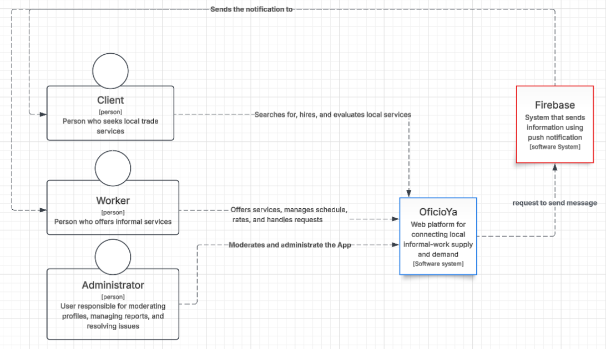

* **Diagrama de Contenedores:** Topología completa de la SPA, API Gateway, microservicios de los 5 squads y motores de persistencia.

  

### Vista Detallada por Microservicio (Componentes, Clases y Entidad-Relación)
*Haz clic en cada dominio para desplegar sus diagramas internos:*

<strong>Squad 1: Orchestrator (API Gateway) & Identity Service</strong>

 

- **Diagrama de Componentes - Orchestrator (C4 Nivel 3):**
  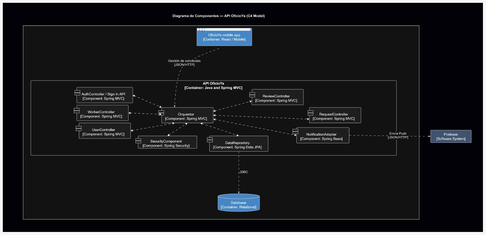

- **Diagrama de Componentes - Identity Service (C4 Nivel 3):**
  

- **Diagrama de Clases:**
  

- **Diagrama Entidad-Relación (ER):**
  

<strong>Squad 2: User Service</strong>

 

- **Diagrama de Componentes (C4 Nivel 3):**
  

- **Diagrama de Clases:**
  

- **Diagrama Entidad-Relación (ER):**
  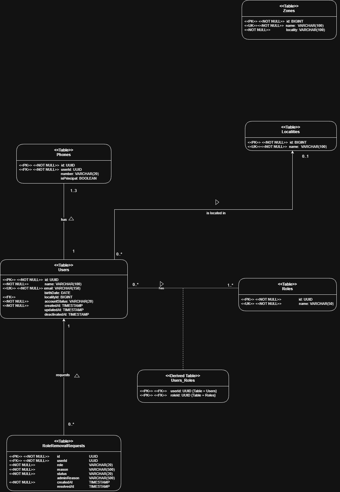

<strong>Squad 3: Worker Service</strong>

 

- **Diagrama de Componentes (C4 Nivel 3):**
  

- **Diagrama de Clases:**
  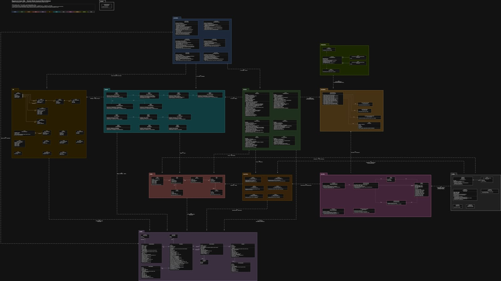

- **Diagrama Entidad-Relación (ER):**
  

<strong>Squad 4: Service Request & Notification Service</strong>

 

- **Diagrama de Componentes - Service Request (C4 Nivel 3):**
  

- **Diagrama de Componentes - Notification Service (C4 Nivel 3):**
  

- **Diagrama de Clases:**
  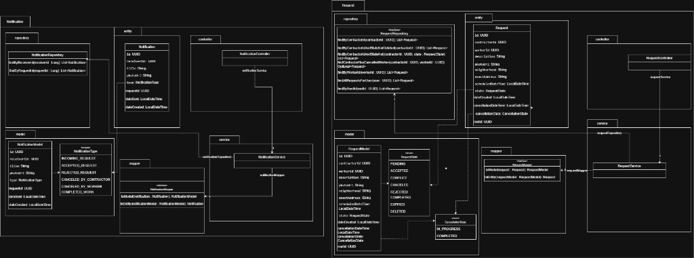

- **Diagrama Entidad-Relación (ER):**
  

<strong>Squad 5: Search, Reputation & Reporting Services</strong>

 

- **Diagrama de Contenedores del Squad:**
  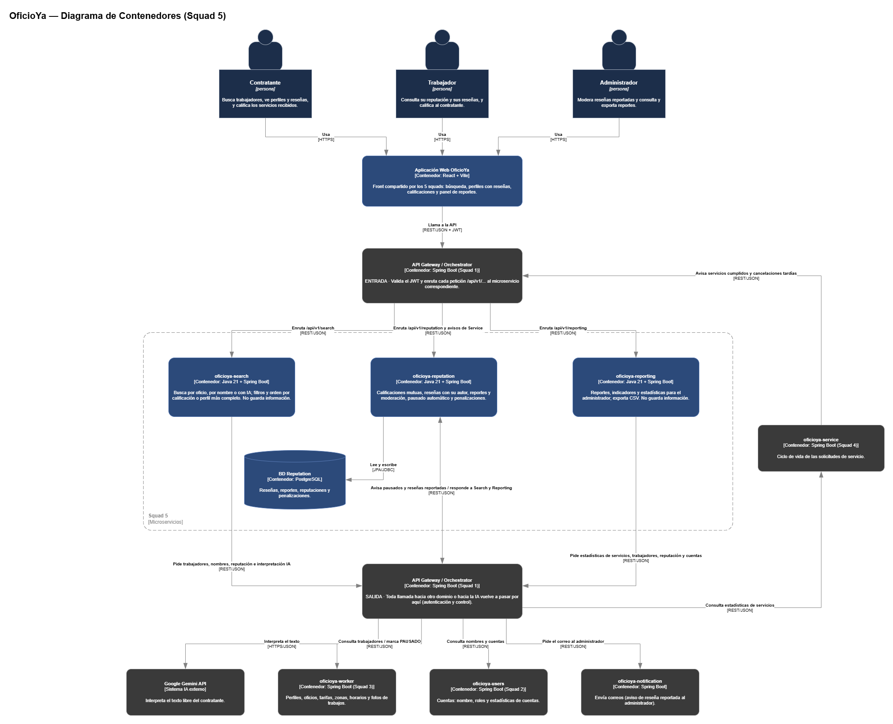

- **Diagramas de Componentes (C4 Nivel 3):**
  - *Search Service:*
    
  - *Reputation Service:*
    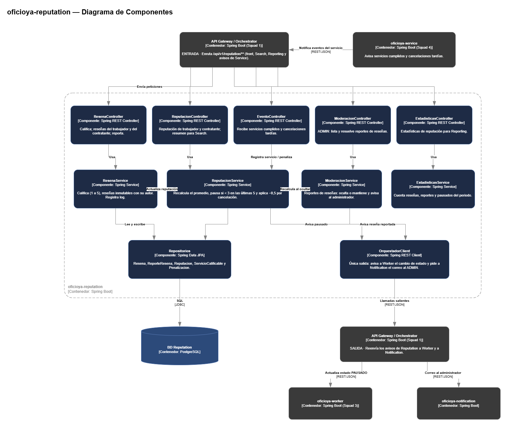
  - *Reporting Service:*
    

- **Diagramas de Clases:**
  - *Search Service:*
    
  - *Reputation Service:*
    
  - *Reporting Service:*
    

- **Diagrama Entidad-Relación (ER):**
  - *Reputation Service:*
    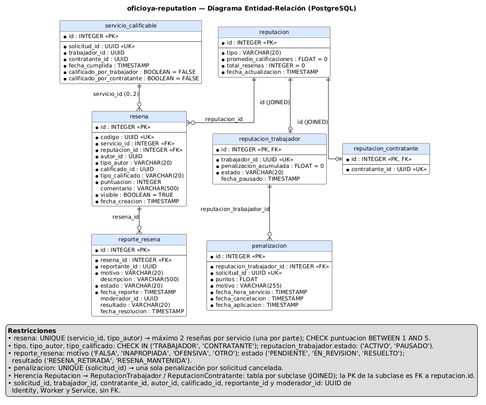
  *(Nota: Search y Reporting operan como servicios en memoria sin base de datos propia, consultando a otros dominios en tiempo real).*

---

## 4. Documentación de APIs (Swagger)

| Microservicio | Squad | Documentación Interactiva | Respaldo Visual |
| :--- | :---: | :--- | :--- |
| **Orchestrator & Identity** | Squad 1 | [Ver Swagger UI](URL_SWAGGER_SQUAD1) | [Ver Captura](docs/swagger-respaldo/swagger-orchestrator-identity.png) |
| **Users** | Squad 2 | [Ver Swagger UI](URL_SWAGGER_USERS) | [Ver Captura](docs/swagger-respaldo/swagger-users.png) |
| **Workers** | Squad 3 | [Ver Swagger UI](URL_SWAGGER_WORKERS) | [Ver Captura](docs/swagger-respaldo/swagger-workers.png) |
| **Service Request** | Squad 4 | [Ver Swagger UI](URL_SWAGGER_SERVICE) | [Ver Captura](docs/swagger-respaldo/swagger-service.png) |
| **Notification** | Squad 4 | [Ver Swagger UI](URL_SWAGGER_NOTIFICATION) | [Ver Captura](docs/swagger-respaldo/swagger-notification.png) |
| **Search** | Squad 5 | [Ver Swagger UI](https://oficioya-search-atgjh5gdfcb5b8h3.mexicocentral-01.azurewebsites.net/swagger-ui/index.html) | [Ver Captura](docs/swagger-respaldo/swagger-search.png) |
| **Reputation** | Squad 5 | [Ver Swagger UI](https://oficioya-reputation-bggabfhkdvaqh4bw.mexicocentral-01.azurewebsites.net/swagger-ui/index.html) | [Ver Captura](docs/swagger-respaldo/swagger-reputation.png) |
| **Reporting** | Squad 5 | [Ver Swagger UI](https://oficioya-reporting-hvehegasb3hrarc9.mexicocentral-01.azurewebsites.net/swagger-ui/index.html) | [Ver Captura](docs/swagger-respaldo/swagger-reporting.png) |

---

## 5. Infraestructura y Despliegues

Cada dominio funcional cuenta con despliegue independiente sobre **Microsoft Azure** y flujos automatizados de integración y entrega continua (**CI/CD**) por repositorio:

| Dominio / Capa | Servicio(s) Desplegado(s) | Proveedor Cloud | Estado |
| :--- | :--- | :---: | :---: |
| **Frontend** | Web App (React + TypeScript) | Microsoft Azure | Activo |
| **Squad 1** | Orchestrator (API Gateway) & Identity Service | Microsoft Azure | Activo |
| **Squad 2** | User Service | Microsoft Azure | Activo |
| **Squad 3** | Worker Service | Microsoft Azure | Activo |
| **Squad 4** | Service Request & Notification Service | Microsoft Azure | Activo |
| **Squad 5** | Search, Reputation & Reporting Services | Microsoft Azure | Activo |

*Haz clic en cada bloque para verificar la evidencia en Azure y su pipeline CI/CD:*

<strong>Frontend — Web App (React + TypeScript)</strong>

 

- **Recurso activo en Azure:**
  
- **Pipeline de despliegue (CI/CD):**
  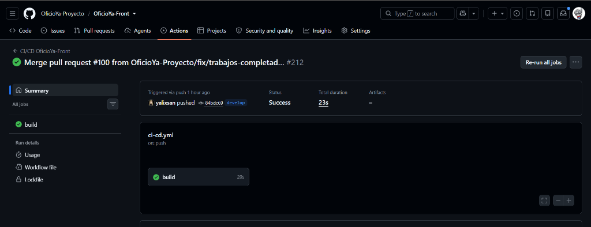

<strong>Squad 1 — Orchestrator & Identity Service</strong>

 

- **Recursos activos en Azure:**
  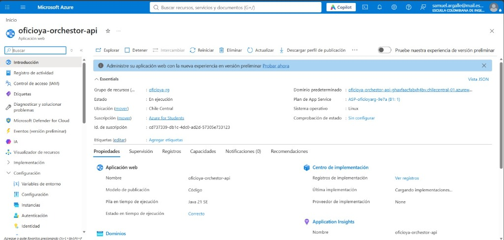
- **Pipeline de despliegue (CI/CD):**
  

<strong>Squad 2 — User Service</strong>

 

- **Recursos activos en Azure:**
  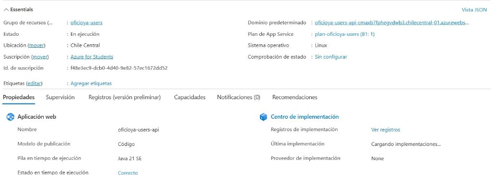
- **Pipeline de despliegue (CI/CD):**
  

<strong>Squad 3 — Worker Service</strong>

 

- **Recursos activos en Azure:**
  
- **Pipeline de despliegue (CI/CD):**
  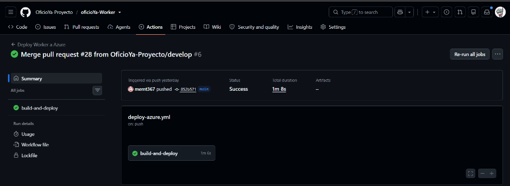

<strong>Squad 4 — Service Request & Notification Service</strong>

 

- **Recursos activos en Azure:**
  
- **Pipeline de despliegue (CI/CD):**
  

<strong>Squad 5 — Search, Reputation & Reporting Services</strong>

 

- **Recursos activos en Azure:**
  
- **Pipelines de despliegue (CI/CD):**
  - *Pipeline Search:*
    
  - *Pipeline Reputation:*
    
  - *Pipeline Reporting:*
    

---

## 6. Gestión Ágil (Scrum + Jira)

Seguimiento de sprints, ceremonias y trazabilidad de historias de usuario durante el desarrollo:

* **Cronograma y Roadmap (Timeline):**
  
* **Tablero de Sprint:**
  
* **Dashboard y Métricas:**
  
